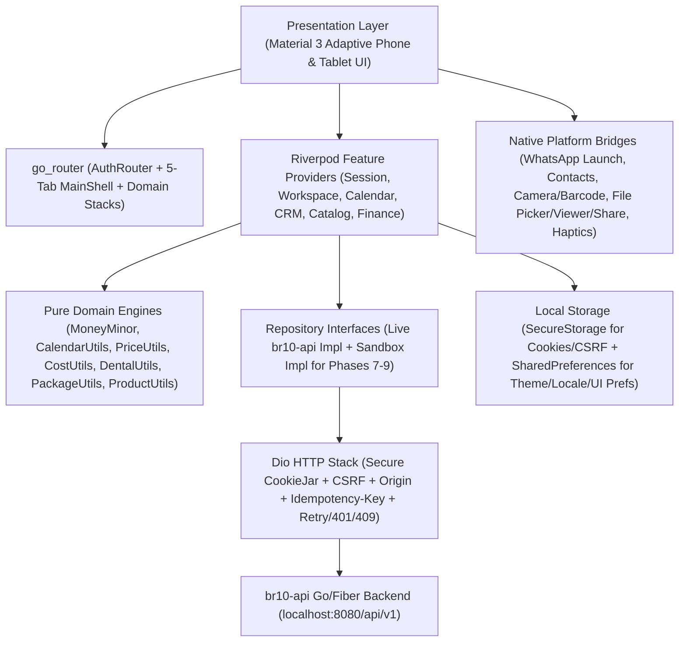
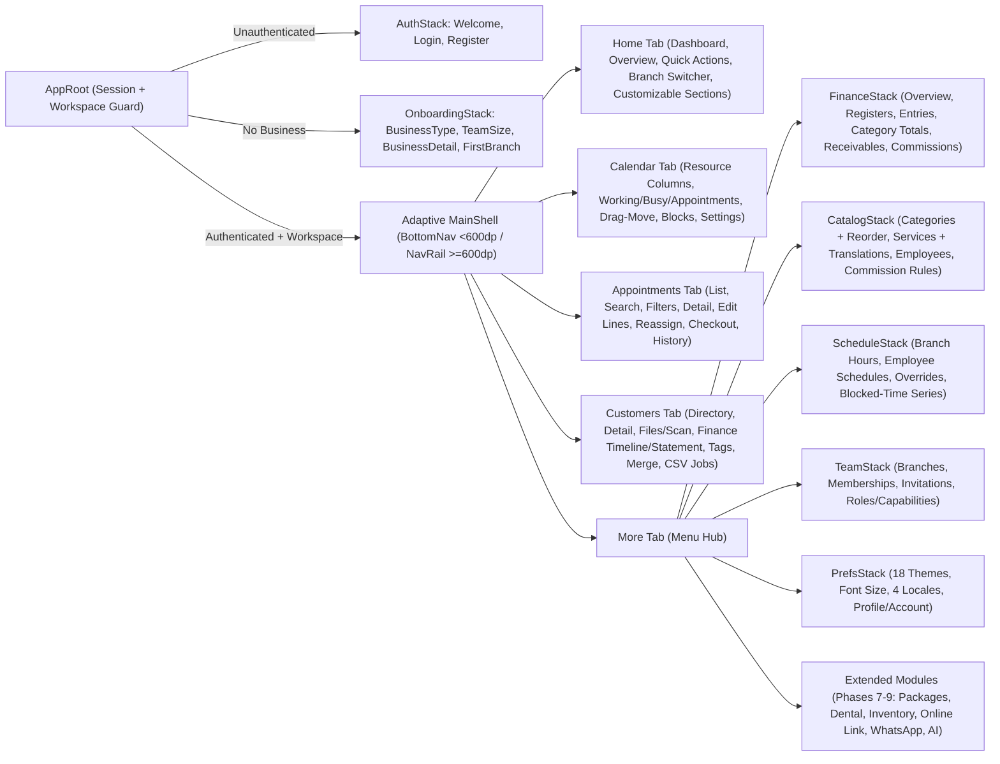

# BR10 Business Mobile App — Full-Parity Flutter Implementation Plan

## Goal Description

Build **BR10 Business** (`com.br10.business`), a production-grade, responsive **Flutter (Android & iOS, phone + tablet)** multi-branch business management mobile application covering the full domain specification in [ANALYSIS.md](file:///Users/maqsudsafin/Documents/GitHub/br10-mobile/ANALYSIS.md) and integrating directly with the live Go/Fiber + PostgreSQL backend in [br10-api](file:///Users/maqsudsafin/Documents/GitHub/br10-api).

### Stack & Architectural Choices
- **Framework**: Flutter 3.41.6 / Dart 3.11.4 (Android minSdk 24, iOS 15+, phone portrait + tablet responsive landscape/split layout)
- **State Management**: `flutter_riverpod` + `riverpod_annotation` (feature-scoped providers with clean global session reset)
- **Routing**: `go_router` with typed shell routes (5-tab `NavigationBar` on compact screens `< 600dp`, `NavigationRail` on tablets `>= 600dp`)
- **Networking**: `dio` + `dio_cookie_manager` + `cookie_jar` (secure persistent cookie jar + CSRF + Origin + Idempotency-Key + strict JSON DTOs)
- **Models & Serialization**: `freezed` + `json_serializable` (zero hand-edits to `.g.dart`/`.freezed.dart`)
- **Localization**: Flutter `gen-l10n` (`.arb` files) supporting **`az` (default), `en`, `ru`, `tr`**
- **Theming**: Material 3 `ThemeData` engine supporting all **18 device-local theme presets** (light & dark), plus font scaling (`small`, `medium`, `large`)
- **Local Storage**: `flutter_secure_storage` (session cookies / CSRF token) + `shared_preferences` (device-local theme, locale, home section visibility, calendar resource order & slot preferences)

---

## User Review Required

> [!IMPORTANT]
> **Critical Protocol Alignment Between `ANALYSIS.md` and `br10-api`**
> Inspecting [br10-api](file:///Users/maqsudsafin/Documents/GitHub/br10-api) revealed that the live backend uses a cleaner, stricter security and data contract than the legacy Rezneed XAPK documented in [ANALYSIS.md](file:///Users/maqsudsafin/Documents/GitHub/br10-mobile/ANALYSIS.md). The mobile app **must** target `br10-api`'s real wire contract:
>
> | Concern | Legacy XAPK (`ANALYSIS.md`) | Live Backend (`br10-api`) | Mobile App Strategy |
> |---|---|---|---|
> | **Base Path** | `/api/*` + `x-branch-id` header | `/api/v1/businesses/:businessID/...` | Tenant-scoped URL paths with active `businessId` & `branchId` |
> | **Auth** | Phone + Password + OTP + Bearer JWT | Email + Password (12–72 chars) + **`HttpOnly` Session Cookie** (`br102_session` / `__Host-session`) | `dio_cookie_manager` + `PersistCookieJar` backed by secure storage |
> | **Mutation Security** | Bearer header | **`Origin`** (`http://localhost:3000` in dev) + **`X-CSRF-Token`** + **`Idempotency-Key` (UUID v4)** | Dedicated `Br10SecurityInterceptor` auto-injecting all 3 headers |
> | **JSON Parsing** | Loose objects | **`DisallowUnknownFields()`** on server | Strict request DTOs separate from read models |
> | **Response Envelope** | `{result, data}` | `{success: true, data}` / `{success: false, code, message, details, request_id}` | Typed `ApiResponse<T>` & `ApiError` parser |
> | **Money & Rates** | Decimal strings + JS floats | **Integer minor units** (`price_minor`, `amount_minor` in AZN qəpik) + **basis points** (`commission_bps` 0..10000) | Exact integer arithmetic (`MoneyMinor` value object) + parity helpers |
> | **Concurrency** | Implicit overwrite | **Optimistic locking (`version: int`)** + HTTP `409 CONFLICT` | Conflict banner + reload/merge flow on 409 |
> | **RBAC** | Client role list fallback | Server-computed `capabilities[]` on `/me/context` & `/businesses/:id` | `CapabilityGate` checking `workspace.capabilities` + role |
> | **File Uploads** | Multipart `/upload/business` | **32 KiB base64 JSON chunks** with SHA-256 + ClamD scan + 60s download tickets | Chunked upload queue + scan-state UI + ticketed download |

> [!WARNING]
> **Backend Feature Coverage Boundary (Phases 1–6 Live vs. Phases 7–9 Extended)**
> Currently, [br10-api/cmd/api/main.go](file:///Users/maqsudsafin/Documents/GitHub/br10-api/cmd/api/main.go) mounts **6 full backend domains**: `identity`, `workspace`, `catalog`, `customer`, `scheduling`, and `finance`.
> The remaining domains from [ANALYSIS.md](file:///Users/maqsudsafin/Documents/GitHub/br10-mobile/ANALYSIS.md) — **Service/Customer Packages, Dental Charting, Inventory/Stock/Suppliers/Technical Cards, Online Booking Link Builder, WhatsApp Cloud/QR Sessions, Stories/Push/Subscriptions, and Streaming SSE AI Catalog Assistant** — do **not** yet have endpoints in `br10-api`.
> - **Phases 1–6** wire **100% live** against `br10-api` (verifiable directly against Docker Compose!).
> - **Phases 7–9** implement the full mobile UI, exact domain algorithms (from Section 6 of `ANALYSIS.md`), and repository abstractions backed by a toggleable **Feature Flag / Local Sandbox Repository**, ready to bind to `br10-api` as those backend endpoints are added.

> [!CAUTION]
> **Git Workflow & AIES Guardrails**
> Per [AGENTS.md](file:///Users/maqsudsafin/Documents/GitHub/br10-mobile/AGENTS.md) and [security/SKILL.md](file:///Users/maqsudsafin/Documents/GitHub/br10-mobile/.agents/skills/security/SKILL.md):
> - All development will happen on dedicated feature branches (e.g., `feat/phase-1-foundation`), never committed or merged directly into `main`.
> - No secrets or `.env` credentials will be committed; API base URL and Origin are injected via `--dart-define` (with safe local dev defaults for Android `10.0.2.2:8080` and iOS `127.0.0.1:8080`).

---

## Open Questions

1. **Phase 7–9 Backend Scope**: When we reach Phases 7–9 (Packages, Dental, Inventory, Online Link, WhatsApp Cloud, AI Assistant), would you like us to keep those modules in **mobile-only local sandbox/repository mode** until you extend `br10-api`, or should we also plan backend endpoint additions in `br10-api` later?
2. **Phase 1 Execution Start**: Once you approve this plan, should we immediately execute **Phase 1 (Project Scaffold, Networking, Auth, Workspace Setup, Theme Engine, 4-Locale l10n, Adaptive App Shell)** on branch `feat/phase-1-foundation` and verify it live against `br10-api` Docker Compose?

---

## System Architecture



### Navigation Architecture (Mapped to `ANALYSIS.md` + `br10-api`)



---

## Proposed Changes (9 Vertical Milestones)

### Repository Directory Layout (`lib/`, `test/`, `integration_test/`, `specs/`)

```text
br10-mobile/
├── pubspec.yaml
├── l10n.yaml
├── analysis_options.yaml
├── specs/                              # OpenSpec delta artifacts per milestone
│   └── phase-1-foundation/
│       ├── proposal.md
│       ├── design.md
│       └── tasks.md
├── lib/
│   ├── main.dart
│   ├── app/
│   │   ├── app.dart                    # MaterialApp.router, locale, theme, font scale
│   │   ├── router/
│   │   │   ├── app_router.dart         # go_router + auth/workspace/capability guards
│   │   │   └── main_shell.dart         # Responsive NavigationBar / NavigationRail + FAB
│   │   └── theme/
│   │       ├── theme_presets.dart      # All 18 presets (BR10, Padel, Blush, Dark, Midnight, ...)
│   │       └── theme_controller.dart   # Device-local preset + light/dark + font scale
│   ├── core/
│   │   ├── config/app_config.dart      # --dart-define API_BASE_URL, API_ORIGIN, feature flags
│   │   ├── network/
│   │   │   ├── api_client.dart         # Dio factory + SecureCookieStorage + interceptors
│   │   │   ├── security_interceptor.dart # Origin, X-CSRF-Token, Idempotency-Key, X-Locale
│   │   │   ├── api_envelope.dart       # ApiResponse<T>, ApiError, PageResponse<T>
│   │   │   └── idempotency.dart        # UUID v4 key generator & retry replay handler
│   │   ├── money/
│   │   │   ├── money_minor.dart        # Exact int64 minor units (AZN ₼) + bps (0..10000)
│   │   │   └── price_utils.dart        # ANALYSIS.md Section 6 monetary/discount/net-sharing utils
│   │   ├── rbac/
│   │   │   └── capability_gate.dart    # CapabilityGate widget + hasCapability() provider
│   │   ├── storage/
│   │   │   ├── secure_store.dart       # Session cookies & CSRF persistence
│   │   │   └── prefs_store.dart        # Locale, theme, home sections, calendar local prefs
│   │   ├── native/
│   │   │   ├── whatsapp_launcher.dart  # Native WhatsApp / WhatsApp Business deep-link handoff
│   │   │   └── file_transfer.dart      # 32 KiB SHA-256 chunked upload + download ticket saver
│   │   └── widgets/                    # Shared design system (sheets, cards, conflict banners, empty/error)
│   ├── l10n/
│   │   ├── app_az.arb                  # Default Azerbaijani dictionary
│   │   ├── app_en.arb                  # English dictionary (derived from ANALYSIS.md Appendix E)
│   │   ├── app_ru.arb                  # Russian dictionary
│   │   └── app_tr.arb                  # Turkish dictionary
│   └── features/
│       ├── auth/                       # Phase 1: Welcome, Login, Register, Session, Logout
│       ├── workspace/                  # Phase 1: Onboarding Wizard, Business/Branch Switcher, Invitations
│       ├── home/                       # Phase 2: Dashboard, Overview, Quick Actions, Customizable Sections
│       ├── catalog/                    # Phase 2: Categories (reorder), Services (i18n/members), Employees, Commissions
│       ├── scheduling/                 # Phase 3: Branch/Employee Hours, Overrides, Availability, Blocks & Series
│       ├── calendar/                   # Phase 3: Resource Grid, Overlap, Smart Pagination, Drag-Move
│       ├── appointments/               # Phase 4: Create/Preview/Detail, Edit Lines, Reassign, Start/Cancel, History
│       ├── customers/                  # Phase 5: CRM, Tags, Batches, Merge, Comm Prefs, Ban, Files/Scan, CSV Jobs
│       ├── finance/                    # Phase 6: Overview, Registers, Ledger, Quote/Checkout, Refunds, Credits, Payouts, Statements
│       ├── packages/                   # Phase 7: Service & Customer Packages (sandbox + future API)
│       ├── dental/                     # Phase 7: Interactive FDI Dental Chart & Treatment Plans
│       ├── inventory/                  # Phase 8: Products, Stock, Suppliers, Supplies, Technical Cards, POS Sales
│       └── extensions/                 # Phase 9: Online Link Builder, WhatsApp Sessions, Notifications, AI SSE Assistant
├── test/
│   ├── core/                           # Unit tests for interceptors, MoneyMinor, Section 6 algorithms
│   └── features/                       # Provider & widget tests per feature
└── integration_test/
    └── api_smoke_test.dart             # End-to-end tests against live br10-api Docker stack
```

---

### Phase 1: Project Scaffold, Core Networking, Auth, Workspace Onboarding, Theme & L10n

**Goal**: Runnable Android/iOS Flutter app that authenticates against live `br10-api`, persists session cookies + CSRF securely, runs the multi-step business onboarding wizard, switches branches/workspaces, enforces server capabilities, and provides 18 theme presets + 4 locales (`az`/`en`/`ru`/`tr`).

#### [NEW] `pubspec.yaml` & `l10n.yaml` & `analysis_options.yaml`
Core dependencies:
- State & DI: `flutter_riverpod`, `riverpod_annotation`
- Routing: `go_router`
- Networking: `dio`, `dio_cookie_manager`, `cookie_jar`, `uuid`
- Serialization: `freezed_annotation`, `json_annotation`
- Storage & Platform: `flutter_secure_storage`, `shared_preferences`, `url_launcher`, `crypto`, `intl`, `flutter_localizations`
- Dev: `build_runner`, `freezed`, `json_serializable`, `riverpod_generator`, `mocktail`, `flutter_lints`

#### [NEW] `lib/core/network/security_interceptor.dart`
Handles `br10-api`'s exact session/CSRF/Origin/Idempotency protocol:
```dart
class Br10SecurityInterceptor extends Interceptor {
  Br10SecurityInterceptor({
    required this.apiOrigin,
    required this.getCsrfToken,
    required this.getLocale,
    required this.onUnauthorized,
  });

  final String apiOrigin;
  final String? Function() getCsrfToken;
  final String Function() getLocale;
  final Future<void> Function() onUnauthorized;

  static const _mutatingMethods = {'POST', 'PUT', 'PATCH', 'DELETE'};

  @override
  void onRequest(RequestOptions options, RequestInterceptorHandler handler) {
    final locale = getLocale();
    options.headers['X-Locale'] = locale;
    options.headers['Accept-Language'] = locale;
    options.headers['Accept'] = 'application/json';

    if (_mutatingMethods.contains(options.method.toUpperCase())) {
      options.headers['Origin'] = apiOrigin;
      options.headers['Content-Type'] = 'application/json';
      final csrf = getCsrfToken();
      if (csrf != null && csrf.isNotEmpty) {
        options.headers['X-CSRF-Token'] = csrf;
      }
      // Preserve caller-supplied key across retries; auto-generate if omitted
      options.headers.putIfAbsent('Idempotency-Key', () => const Uuid().v4());
    }
    handler.next(options);
  }

  @override
  Future<void> onError(DioException err, ErrorInterceptorHandler handler) async {
    final status = err.response?.statusCode;
    final path = err.requestOptions.path;
    if (status == 401 && !path.contains('/auth/login') && !path.contains('/auth/register')) {
      await onUnauthorized();
    }
    handler.next(err);
  }
}
```

#### [NEW] `lib/core/money/money_minor.dart`
Exact integer minor-unit + basis-point arithmetic matching `br10-api`:
```dart
@immutable
class MoneyMinor {
  const MoneyMinor(this.minor, {this.currency = 'AZN'});
  final int minor; // e.g., 1250 = 12.50 ₼
  final String currency;

  String get symbol => currency == 'AZN' ? '₼' : currency;

  /// Compute exact basis-point share: round(minor * bps / 10000)
  MoneyMinor applyBps(int bps) => MoneyMinor((minor * bps + 5000) ~/ 10000, currency: currency);

  String format({bool withSymbol = true}) {
    final sign = minor < 0 ? '-' : '';
    final abs = minor.abs();
    final major = abs ~/ 100;
    final frac = (abs % 100).toString().padLeft(2, '0');
    final core = '$sign$major.$frac';
    return withSymbol ? '$core $symbol' : core;
  }
}
```

#### [NEW] Auth & Workspace Screens (`lib/features/auth/`, `lib/features/workspace/`)
- **Auth**: `WelcomeScreen` (animated slogans), `LoginScreen` (email + password), `RegisterScreen` (name 2–255, email, password 12–72 UTF-8 bytes), session bootstrap via `GET /api/v1/auth/session` + `GET /api/v1/me/context`, logout via `POST /api/v1/auth/logout` with full provider reset while preserving local theme/locale/UI preferences.
- **Business Onboarding Wizard**: `BusinessTypeScreen` (`BARBER`, `BEAUTY_SALON`, `DENTAL`, `SPA`, `OTHER`), `TeamSizeScreen` (`SOLO`, `SMALL`, `GROWING`, `LARGE`), `BusinessDetailScreen` (name, slug, currency `AZN`), `FirstBranchScreen` (name, city, address, E.164 phone, IANA timezone) → `POST /api/v1/businesses`.
- **Workspace & Access**: Multi-branch switcher, `BranchesScreen` (create/edit/archive/restore with `version` optimistic locking), `TeamMembersScreen` (memberships + role editing + capabilities), `InvitationsScreen` (business invites send/cancel + `/me/invitations` accept/decline).
- **Theme & Locale**: `ThemeScreen` (live preview + 18 presets + light/dark + font size), Language picker (`az` default, `en`, `ru`, `tr`).

---

### Phase 2: Home Dashboard & Service Catalog + Employees + Commission Rules

**Goal**: Complete operational home hub and full catalog management wired to live `br10-api` `/catalog/*` and `/finance/overview`.

#### [NEW] `lib/features/home/`
- `MainScreen` (Home Tab): Branch selector header, customizable section visibility persisted locally (`STORIES`, `APPOINTMENTS`, `FINANCE`, `OVERVIEW`, `SERVICES` per `ANALYSIS.md` F2927), today's upcoming appointments summary, finance overview cards (gated by `finance:read`), service shortcuts, quick booking FAB, pull-to-refresh.

#### [NEW] `lib/features/catalog/`
- **Categories**: `CategoriesScreen`, create/edit sheet (`POST/PUT /categories`), drag-and-drop reorder (`GET /categories/order`, `POST /categories/reorder`).
- **Employees**: `EmployeesScreen`, `EmployeeDetailScreen` (tabs: General, Branches, Commission %, Working Hours link, Online), create/edit (`POST/PUT /employees` with `commission_bps`, `branch_ids`, active toggle).
- **Services**: `ServicesScreen` (category grouping, search, active/archived filter), `ServiceEditorScreen` (pricing types `FIXED | RANGE | FROM | FREE | NO_PRICE`, `price_minor`/`price_max_minor`, `duration_minutes` 5..1440, `online_booking` rule enforcing `>= 1` employee, 4-language `translations` tab `az/en/ru/tr`, per-employee `MemberInput` price/duration/commission overrides).
- **Commission Rules**: Single, Multi, and Batch commission preview & apply workflows (`POST /catalog/commissions/{preview,apply}`, `/catalog/commission-rules/{preview,apply}`, `/catalog/commission-rules/multi/{preview,apply}`).

---

### Phase 3: Work Schedules, Blocked Times & Interactive Resource Calendar

**Goal**: Full scheduling engine and multi-employee calendar grid with drag-and-drop rescheduling, working/busy overlays, and weekly recurring blocked-time series.

#### [NEW] `lib/features/scheduling/`
- **Branch & Employee Working Hours**: `WorkingHoursScreen` & `EmployeeScheduleScreen` (`GET/PUT /branches/:branchID/schedules/{branch,employees/:employeeID}`): 7-day weekly windows (max 4 non-overlapping windows/day), breaks strictly contained inside windows, `online_windows` & `online_disabled`, `inherit_branch` toggle for employees, `lead_minutes` (0..240), date-specific `overrides` (up to 366).
- **Blocked Times & Weekly Series**: `BlockedTimeScreen` (single blocks + DST-safe local time resolution via `GET /local-times/resolve`), `BlockedTimeSeriesScreen` (1–91 day weekly rules, cancel series, individual occurrence move/restore/reattach).
- **Availability Preview**: Single-service (`GET /availability/preview`) and multi-service cart availability (`POST /appointments/availability`).

#### [NEW] `lib/features/calendar/`
- `CalendarScreen`: Wired to `GET /businesses/:businessID/calendar` (`from_date`, `through_date` up to 7 days, `branch_id`, `employee_id`, `resource_offset` step 30, `status`).
- **Pure Client Calendar Engine (`lib/features/calendar/domain/calendar_utils.dart`)**:
  - Smart resource column pagination (auto 3–4 columns on phone, responsive wider count on tablet, avoiding 1-column orphan last page).
  - Half-open overlap detection (`a.start < b.end && a.end > b.start`), working-window shading, busy/block shading, load density indicator (`>=0.75` red, `>=0.40` orange, else green).
  - Drag-to-move appointment gesture with no-op detection and confirmation calling `POST /appointments/:id/move`.
- **Personal Calendar Settings**: `CalendarSettingsScreen` (slot granularity 15/30/60m, status colors, font size, only-working-employees filter) and `CalendarResourcesScreen` (device-local personal employee column ordering/visibility).

---

### Phase 4: Appointments Lifecycle, Booking Flow & Audit History

**Goal**: End-to-end appointment creation, preview, multi-service cart editing, employee reassignment, status transitions, and role-scoped audit history.

#### [NEW] `lib/features/appointments/`
- **Appointments List**: `AppointmentsScreen` with status filter (`ACTIVE`, `BOOKED`, `STARTED`, `COMPLETED`, `CANCELLED`), date range presets, employee filter, infinite-scroll pagination (`limit`/`offset`).
- **Booking Wizard**: Multi-service cart selector → employee & slot picker (powered by `POST /appointments/availability` + `POST /appointments/preview`) → customer selector → `POST /appointments` with `Idempotency-Key`.
- **Appointment Detail (`AppointmentScreen`)**:
  - `GET /appointments/:id` with version-aware actions:
    - **Start** (`POST /appointments/:id/start`)
    - **Move / Reschedule** (`POST /appointments/:id/move`)
    - **Edit Service Lines** (`POST /appointments/:id/lines` — updates ordered services/quantities on `BOOKED` appointments, warns that stale checkout quotes will regenerate)
    - **Reassign Employee** (`POST /appointments/:id/reassign` — updates price/duration/commission snapshot)
    - **Cancel** (`POST /appointments/:id/cancel` with localized cancellation reasons)
    - **Checkout / Receipt** (navigates to Phase 6 Finance Checkout flow)
  - **History (`AppointmentHistoryScreen`)**: Role-scoped revision history (manager sees full before/after snapshots; reception/employee sees restricted projection).
  - **WhatsApp Quick Message**: Native handoff via `WhatsAppLauncher` (`whatsapp://send?phone=...` with WhatsApp & WhatsApp Business detection).

---

### Phase 5: Customer CRM, Tags, Private Scanned Files, Merge & CSV Bulk Jobs

**Goal**: Full customer CRM matching every endpoint in `br10-api/internal/features/customer/` plus phone contacts import.

#### [NEW] `lib/features/customers/`
- **Customer Directory & Detail**: `CustomersScreen` (search, branch/tag/state filters, pagination), `CustomerDetailScreen` (tabs: Details, Appointments, Finance Timeline/Statement, Files, Settings), `AddEditCustomerScreen` (plus device Contacts import via `flutter_contacts`).
- **Tags & Batch Operations**: `CustomerTagsScreen` (tag CRUD with color palette from `ANALYSIS.md` F1484), multi-select batch tag assignment, lifecycle batches (archive/restore), branch batches.
- **Customer Merge**: `CustomerMergeScreen` (select duplicate pair → preview merged result → commit with `Idempotency-Key`).
- **Communication Preferences & Booking Ban**: `CustomerSettingsScreen` (`GET/PUT` communication preferences + booking ban toggle/reason, gated by `customers:write`).
- **Private Customer Files (`CustomerDocumentsScreen`)**:
  - Storage quota usage indicator (`used / reserved / available` bytes).
  - **32 KiB Chunked Uploader**: Computes full file SHA-256, verifies magic bytes (`PDF`, `PNG`, `JPEG`), registers file, uploads base64 JSON chunks sequentially (`POST .../files/:fileID/upload`) with progress bar & resumable idempotency.
  - **ClamD Scan State Badges**: `PENDING_UPLOAD`, `QUARANTINED` (`WAITING`/`SCANNING`/`DEAD`), `CLEAN`, `REJECTED` + manager **Retry Rescan** button.
  - **Secure 60s Download Ticket**: Requests manager-only single-use download ticket, streams binary file, opens in native viewer (`ImageViewScreen` / `FilesViewerScreen` / `open_filex`).
  - **Audited Content Removal** (requires reason) & **File Audit History** timeline.
- **CSV Import & Bulk Update Jobs**: `CustomerCsvJobsScreen` (upload/stage, preview, review conflicts, apply, view results/history, cancel).

---

### Phase 6: Finance, Checkout, Cash Registers, Commissions & Statements

**Goal**: Complete financial suite backed by `br10-api/internal/features/finance/`, including exact quote/checkout, split payments, collections, refunds, bill credits, commission payouts/returns, and exportable statements.

#### [NEW] `lib/features/finance/`
- **Finance Hub & Overview**: `FinanceScreen` (capability-gated menu rows) & `FinanceDashboardScreen` (`GET /finance/overview` by branch + date range, interactive charts using `fl_chart`).
- **Appointment Checkout Flow**:
  - `QuoteScreen`: Creates/reads checkout quote (`POST/GET /appointments/:id/quote`) with discounts, line totals, and exact minor-unit breakdown.
  - `CheckoutScreen` & `PaymentScreen`: Single or **split payment** across active same-branch cash registers (`CASH` / `CARD`), submits `POST /appointments/:id/checkout` with `Idempotency-Key`, supports command-status polling (`GET /finance/commands/:requestKey`) on network timeout.
  - `ReceiptScreen`: Renders `GET /appointments/:id/checkout/document` (`az`/`en`) with print/share/export (`share_plus`).
- **Post-Checkout Operations**:
  - **Receivables & Collections**: `ReceivablesScreen` (`GET /finance/receivables`), record subsequent payments (`POST /appointments/:id/checkout/collections`).
  - **Refunds**: `RefundSheet` (source selection → `POST .../refunds/preview` → `POST .../refunds`).
  - **Bill Credits**: `BillCreditSheet` (`POST .../credits/preview` → `POST .../credits`, respecting paid commission floor).
- **Cash Registers & Ledger**:
  - `CashRegistersScreen` (`GET/POST/PUT /registers`, active/archived filter) & `RegisterStatementScreen` (`GET /registers/:id/statement` with category filter).
  - `FinanceCategoriesScreen` (`GET/POST/PUT /finance/categories`) & `CategoryTotalsScreen` (`GET /finance/category-totals` + exportable document).
  - `LedgerEntryScreen`: Post manual income/expense/transfer (`POST /finance/entries`) & reverse entry (`POST /finance/entries/:id/reverse`).
- **Employee Commissions**:
  - `CommissionDirectoryScreen` (`GET /finance/commissions` — OPEN/SETTLED/ALL balances).
  - `EmployeeCommissionsScreen` (`GET /employees/:id/commissions`) & `CommissionStatementScreen` (`GET /employees/:id/commission-statement` — up to 31 days, reconciling `opening + accrued - credited - paid + returned = closing`).
  - `CommissionPayoutSheet` (`POST /appointments/:id/checkout/commission-payouts`) & `CommissionReturnSheet` (`POST .../commission-payouts/:payoutID/returns`).
- **Customer Financial Profile**:
  - `CustomerFinanceScreen` (`GET /finance/customers`, `GET /customers/:id/finance`, `/timeline` with running debt, `/statement` up to 31 days, `/statement/document` JSON/HTML/CSV preview & share).

---

### Phase 7: Service & Customer Packages + Dental Plan Charting *(Extended Spec — Sandbox/Future API)*

**Goal**: Implement the exact UI, state, and verified client algorithms from `ANALYSIS.md` Sections 2, 4, and 6 behind repository interfaces (defaulting to local sandbox repository until `br10-api` adds these endpoints).

#### [NEW] `lib/features/packages/`
- `PackageUtils` exact rules: `isExpired`, `resolveDisplayStatus` (`EXPIRED > DEACTIVE > DRAFT > ACTIVE`), `getMaxUsage` (`min` across items), `calculateItemsTotal`, `toInitialTotalOverride`/`resolveTotalAmount`, `SEANS` vs `MIN` unit display.
- Screens: `PackagesScreen`, `NewPackageScreen`, `SellPackageScreen`, `SelectPackageScreen`, `PackageDetailScreen` (INFO / USAGE / PAYMENTS tabs).

#### [NEW] `lib/features/dental/`
- `DentalUtils` exact rules: `toggleTooth`, `toPlans`/`fromPlans` (string teeth in editor ↔ numeric `items` on wire), `buildOptions` (`{type: 'DENTIST', data: {plans: [...]}}`), `findInvalidRow`.
- Screens: Interactive `DentalPlanScreen` (permanent 32-tooth + primary 20-tooth FDI chart selector, service binding, treatment notes) + Customer `DENTAL` tab.

---

### Phase 8: Inventory, Stock, Suppliers, Supplies, Technical Cards & POS Sales *(Extended Spec — Sandbox/Future API)*

**Goal**: Complete inventory and POS product-sale/material-usage module with barcode scanning and exact box/measure arithmetic from `ANALYSIS.md` Section 6.

#### [NEW] `lib/features/inventory/`
- `ProductUtils` & `CostUtils` exact rules: `measureTotal`, `availableMeasure`, `initialMeasure`, `isMeasureValid`, `calculateUsageEditMetrics`, `calculateEditProductMetrics`, `preparePaymentItems` (`quantity=0` + `quantity_measure` for fractional material usage), `mergeServiceTemplates`, `reconcileAppointmentCost`, supplier ceil-to-whole-box summary.
- Screens: `InventoryScreen`, `ProductsScreen` (with `mobile_scanner` barcode lookup), `StockScreen`, `SuppliersScreen`, `SuppliesScreen` / `NewSupplyScreen` (approve/draft/return), `TechnicalCardsScreen` / `NewTechnicalCardScreen`, `SalesScreen` / `NewSalesScreen` / `SalesDetailsScreen` (dual `SALE` vs `PRODUCT_USAGE` modes).

---

### Phase 9: Online Booking Link, WhatsApp Sessions, Notifications, Subscriptions & Streaming AI Assistant *(Extended Spec + Platform Polish)*

**Goal**: Complete the remaining UX surfaces from `ANALYSIS.md` plus tablet polish, accessibility audit, and release readiness.

#### [NEW] `lib/features/extensions/`
- **Online Booking Link**: `OnlineBookingLinkScreen` (interval, auto availability, pending times dependency, customer note, uploads toggle, step builder config, shareable `link.<domain>/<slug>`).
- **WhatsApp Cloud Sessions**: `WhatsAppScreen` (branch-linked sessions, QR/code display, status badges `CONNECTED | SCAN-QR-CODE | STARTING | FAILED | STOPPED | NOT-FOUND`, restart/logout/remove).
- **Notifications & Subscriptions**: `NotificationsScreen`, `NotificationsSettingsScreen`, `SubscriptionBanner`, `SubscriptionExpiredScreen` (loop-safe guard matching `ANALYSIS.md` F10385/F22902).
- **Streaming SSE AI Assistant**: `AiScreen`, `AiHistoryScreen`, line-oriented `SseReader` (`data:` JSON event dispatch for `delta | activity | notice | widget | confirm | done | error`), `ChatStreamHandler` (50ms flush cadence, abort/retry), attachment validation (12 MiB file / 20 MiB image), interactive confirmation cards (`tool:confirm` / `tool:cancel`), editable staged service drafts.
- **Final Polish**: Run `flutter_a11y_agent` accessibility audit across all primary screens, verify Android + iOS release builds and tablet layouts.

---

## Verification Plan

### Automated Tests

Every milestone follows the [Flutter Verification Reference](file:///Users/maqsudsafin/Documents/GitHub/br10-mobile/.agents/skills/mobile-flutter/references/verification.md):

1. **Codegen Cleanliness Check** (whenever `@freezed` / `@JsonSerializable` / `@riverpod` files change):
   ```bash
   dart run build_runner build --delete-conflicting-outputs
   git diff --exit-code -- '**/*.g.dart' '**/*.freezed.dart'
   ```
2. **Static Analysis & Formatting Gate**:
   ```bash
   dart format --set-exit-if-changed .
   dart analyze
   ```
3. **Unit & Widget Test Suite**:
   ```bash
   flutter test
   ```
   Unit tests will explicitly assert:
   - `Br10SecurityInterceptor`: cookie jar persistence, `Origin`, `X-CSRF-Token`, `Idempotency-Key` preservation on retry, `401` session cleanup, `409` conflict mapping.
   - `MoneyMinor` & all Section 6 business algorithm test vectors from `ANALYSIS.md` (price normalization, proportional cent-remainder discount allocation, net-sharing breakdown, cost-item reconciliation, half-open calendar overlap, smart resource pagination, package usage/expiry, dental round-trip, product measure/box calculations).
   - `CapabilityGate` visibility across `ADMIN`, `MANAGER`, `RECEPTION`, `EMPLOYEE`.
   - Widget tests for auth forms, onboarding wizard, calendar layout, checkout split-payment validation, and 4-locale rendering.
4. **Live Backend Integration Tests (against `br10-api` Docker Compose)**:
   ```bash
   # Start backend stack
   (cd /Users/maqsudsafin/Documents/GitHub/br10-api && docker compose up -d)
   # Verify health
   curl -f http://127.0.0.1:8080/healthz && curl -f http://127.0.0.1:8080/readyz
   # Run Flutter API contract & end-to-end smoke tests against live br10-api
   flutter test test/integration/live_api_contract_test.dart --dart-define=RUN_LIVE_API_TESTS=true --dart-define=API_BASE_URL=http://127.0.0.1:8080/api/v1 --dart-define=API_ORIGIN=http://localhost:3000
   ```
5. **Platform Build Verification** (macOS host with Xcode & Android SDK):
   ```bash
   flutter build apk --debug
   flutter build ios --debug --no-codesign
   ```

### Manual Verification
1. **End-to-End Flow on iOS Simulator & Android Emulator**:
   - Register new account → complete 4-step Business + First Branch setup → confirm persistence across full app restart.
   - Create category, employee, service (with `az`/`en` translations) → configure branch/employee working hours → book multi-service appointment on Calendar → drag-move appointment → start → quote → split cash/card checkout → view receipt & register statement → pay employee commission.
   - Create customer → add tag → upload PDF/image (verify chunked upload + ClamD scan badge + download ticket) → view customer finance timeline & statement.
   - Switch between all 4 locales (`az`, `en`, `ru`, `tr`), toggle Dark/Light + multiple theme presets, verify tablet landscape layout (`>= 600dp` `NavigationRail` + rotation enabled) vs phone portrait layout.
2. **RBAC Role Verification**:
   - Invite a second user as `RECEPTION` and as `EMPLOYEE`, accept invitation, and confirm Finance/Settings/Contacts views respect server `capabilities[]`.
